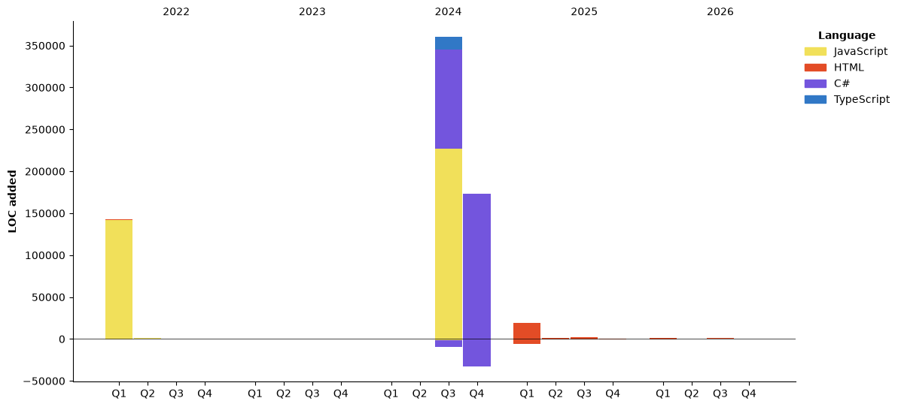

## Hi there 👋

<!--
**Latisha19/Latisha19** is a ✨ _special_ ✨ repository because its `README.md` (this file) appears on your GitHub profile.

Here are some ideas to get you started:

- 🔭 I’m currently working on ...
- 🌱 I’m currently learning ...
- 👯 I’m looking to collaborate on ...
- 🤔 I’m looking for help with ...
- 💬 Ask me about ...
- 📫 How to reach me: ...
- 😄 Pronouns: ...
- ⚡ Fun fact: ...
-->

<!--START_SECTION:waka-->


**🐱 My GitHub Data** 

> 📦 793.2 kB Used in GitHub's Storage 
 > 
> 🏆 30 Contributions in the Year 2026
 > 
> 🚫 Not Opted to Hire
 > 
> 📜 4 Public Repositories 
 > 
> 🔑 14 Private Repositories 
 > 
**I'm an Early 🐤** 

```text
🌞 Morning                153 commits         ███████░░░░░░░░░░░░░░░░░░   26.24 % 
🌆 Daytime                309 commits         █████████████░░░░░░░░░░░░   53.00 % 
🌃 Evening                112 commits         █████░░░░░░░░░░░░░░░░░░░░   19.21 % 
🌙 Night                  9 commits           ░░░░░░░░░░░░░░░░░░░░░░░░░   01.54 % 
```
📅 **I'm Most Productive on Wednesday** 

```text
Monday                   69 commits          ███░░░░░░░░░░░░░░░░░░░░░░   11.84 % 
Tuesday                  106 commits         █████░░░░░░░░░░░░░░░░░░░░   18.18 % 
Wednesday                122 commits         █████░░░░░░░░░░░░░░░░░░░░   20.93 % 
Thursday                 108 commits         █████░░░░░░░░░░░░░░░░░░░░   18.52 % 
Friday                   109 commits         █████░░░░░░░░░░░░░░░░░░░░   18.70 % 
Saturday                 28 commits          █░░░░░░░░░░░░░░░░░░░░░░░░   04.80 % 
Sunday                   41 commits          ██░░░░░░░░░░░░░░░░░░░░░░░   07.03 % 
```


📊 **This Week I Spent My Time On** 

```text
🕑︎ Time Zone: Asia/Taipei

💬 Programming Languages: 
Other                    13 hrs 15 mins      ██████████████████░░░░░░░   71.75 % 
C#                       2 hrs 28 mins       ███░░░░░░░░░░░░░░░░░░░░░░   13.44 % 
Markdown                 1 hr 49 mins        ██░░░░░░░░░░░░░░░░░░░░░░░   09.88 % 
Binary                   41 mins             █░░░░░░░░░░░░░░░░░░░░░░░░   03.70 % 
ASP.NET                  8 mins              ░░░░░░░░░░░░░░░░░░░░░░░░░   00.81 % 

🔥 Editors: 
WorkBuddyAI              6 hrs 27 mins       █████████░░░░░░░░░░░░░░░░   34.93 % 
Visual Studio            3 hrs 52 mins       █████░░░░░░░░░░░░░░░░░░░░   20.97 % 
Fork                     3 hrs 9 mins        ████░░░░░░░░░░░░░░░░░░░░░   17.14 % 
Obsidian                 1 hr 47 mins        ██░░░░░░░░░░░░░░░░░░░░░░░   09.72 % 
LINQPad8(X64)            1 hr 28 mins        ██░░░░░░░░░░░░░░░░░░░░░░░   08.00 % 

💻 Operating System: 
Windows                  18 hrs 28 mins      █████████████████████████   100.00 % 
```

🤖 **AI Coding This Week** 

```text
No AI Coding Activity Tracked This Week
```

**I Mostly Code in JavaScript** 

```text
JavaScript               9 repos             ███████████░░░░░░░░░░░░░░   45.00 % 
C#                       7 repos             █████████░░░░░░░░░░░░░░░░   35.00 % 
HTML                     2 repos             ██░░░░░░░░░░░░░░░░░░░░░░░   10.00 % 
Jupyter Notebook         1 repo              █░░░░░░░░░░░░░░░░░░░░░░░░   05.00 % 
TypeScript               1 repo              █░░░░░░░░░░░░░░░░░░░░░░░░   05.00 % 
```


**Timeline**




 Last Updated on 23/11/2026 06:39:03 UTC
<!--END_SECTION:waka-->
